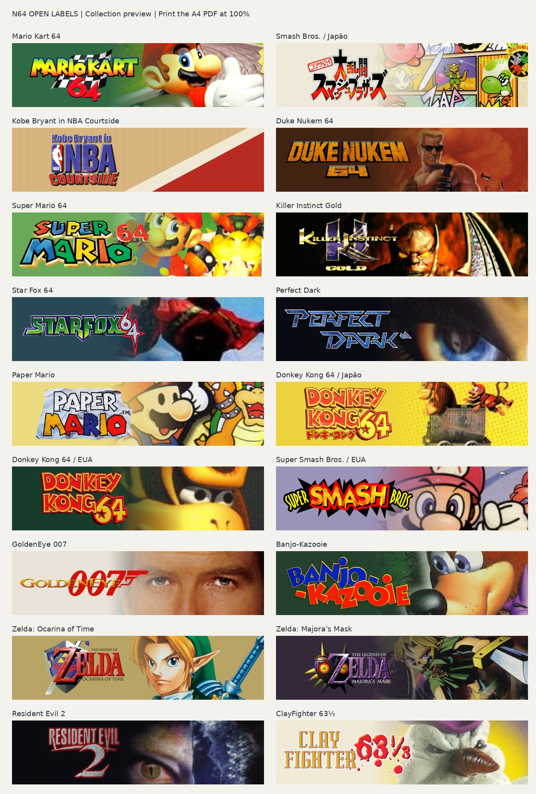

# N64 Open Labels

Printable Nintendo 64 end labels with original-era visual references and a shared, integrated layout. Community project initiated by Rafa.

**Status: 18 printable labels available; worldwide set still in progress.** The initial 18 label compositions were visually approved by the project owner. The worldwide coverage file currently contains **867 candidate regional/language entries requiring review**, not 867 distinct games. No physical fit or print-color validation has been recorded yet.

## Download and print

[**Printable A4 PDF (18 labels)**](prints/collection-18/labels-A4.pdf) | [**Individual PNGs and gallery**](prints/collection-18/)



Print the PDF at **100% / actual size**. The individual PNGs are exported at 600 DPI (1488 × 378 px); this output resolution does not increase the detail of the original scans. The PDF preserves exact 63 × 16 mm dimensions.

## Quick start

Python 3.10 or later:

```sh
python -m pip install -r requirements.txt
python build.py
```

The default demo uses original geometric artwork and produces an A4 PDF, an embedded-image SVG and an enlarged proof in `rendered/`. No game artwork or ROM is needed to test the generator.

To regenerate the published initial collection, install Poppler (`sudo apt install poppler-utils` on Ubuntu/Debian, or `brew install poppler` on macOS), then run from the repository root:

```sh
python export_collection.py --config examples/collection-18.json --asset-pack prints/collection-18/collection-18-assets.zip --output rendered/collection
```

This produces the A4 PDF, 18 individual PNGs, a contact sheet and a SHA-256 manifest. The asset ZIP is read into a temporary directory and does not overwrite the checkout. Future completed recipe sets use the same command with their own config and asset pack. Catalog rows without artwork and recipes cannot be rendered.

For selected labels or editable SVG pages, extract the asset pack into the repository root, then use the original renderer:

```sh
python -m zipfile -e prints/collection-18/collection-18-assets.zip .
python build.py --config examples/collection-18.json --select 0,3,5 --output rendered/selected
```

`--select` uses zero-based recipe indexes. This example selects Mario Kart 64, Duke Nukem 64 and Killer Instinct Gold. See [ASSETS.md](ASSETS.md) for the separate status of third-party game artwork.

## Print at home

Use the generated A4 PDF at **100% / actual size**, with page scaling disabled. Measure the 50 mm calibration ruler. Each label is 63 × 16 mm. Test a label on plain paper against your own cartridge before cutting adhesive stock. Paper, printer margins, ink and adhesive affect the result. This release does not provide bleed or US Letter layouts.

## Visual rule

The logo and artwork must look like one environment. Use a compatible background and a soft transition, with artwork continuing behind the title. The common system fixes dimensions, margins and title placement; the crop and transition remain individually adjustable.

- Label: 63 × 16 mm.
- Logo bounding box: x 1.8, y 1.3, width 32.5, height 13.4 mm; never distort its aspect ratio.
- Default artwork viewport: [24, 0, 39, 16] mm.
- Default fade: x 24 to 43 mm; adjust to protect faces and title contrast.
- No frame, dividing line or separate artwork panel.
- NBA Courtside uses the court itself as its environment. Killer Instinct Gold blends the scene into black.
- Preserve the actual title and regional identity. Duke Nukem 64 and Duke Nukem: Zero Hour are separate games; both belong in the complete catalog.

The approved collection uses a Japanese box logo for DK64 and period artwork of Link for Ocarina of Time. These are horizontal adaptations, not exact reproductions of cartridge fronts. Scans remain raster images inside PDF/SVG.

## Worldwide coverage

Scope: original commercial N64 cartridge releases worldwide and distinct regional packaging. Start with USA, then Japanese and European variants plus other regional releases. ROM revisions are not automatically new label designs. A language tag alone does not prove different packaging. iQue, 64DD, prototypes, later aftermarket releases and special editions need separate scope decisions; they are not silently counted as finished N64 cartridge labels.

- [Coverage backlog](catalog/coverage.csv): imported candidate entries, all `needs_catalog_review`.
- [Provenance](catalog/provenance.json): upstream version, hash, extraction rules and limitations.
- [Initial collection](examples/collection-18.json): 18 visually approved recipes; regional matching, asset provenance and physical proof are still pending.
- [Roadmap](docs/ROADMAP.md): completion gates.

Import a newer local Libretro/No-Intro DAT into a **new staging directory**, then review changes before merging. Importing over the coverage file resets its review fields.

```sh
python scripts/import_catalog.py path/to/Nintendo-64.dat --out catalog/staging
```

This reads metadata only. The project does not request, fetch or distribute ROMs.

## Contributing

See [CONTRIBUTING.md](CONTRIBUTING.md). Supply the exact edition, sources, rights information, recipe, enlarged proof and physical print notes. One reviewed title/region per contribution is easier to maintain than an unreviewed bulk art import.

## License

Original source code, documentation, blank template and demo graphics: MIT, see [LICENSE](LICENSE). DejaVu Sans retains its own license in `assets/DejaVu-LICENSE.txt`. Imported metadata retains its provenance; no claim of ownership is made over game names. Nintendo and publisher logos, characters, scans and artwork are **not** licensed under MIT by this project. Making the generator open source does not establish permission to redistribute those assets or the PDFs that embed them. See [ASSETS.md](ASSETS.md).

This is an unofficial fan project, not affiliated with Nintendo or game publishers.

---

## Resumo em português

Gerador aberto de end labels N64 no padrão aprovado: logo e arte no mesmo ambiente, 63 × 16 mm e PDF A4 em tamanho real. A versão inicial traz o gerador funcional, demonstração sem artes de jogos, 18 receitas aprovadas e uma fila mundial de variantes para revisão. O catálogo completo ainda não foi desenhado. A coleção inicial já está disponível em PDF A4 e PNGs em `prints/collection-18/`, com o pacote de imagens necessário para regenerá-la. Não é necessário executar código para imprimir. Contribuições podem ser feitas em português ou inglês.
